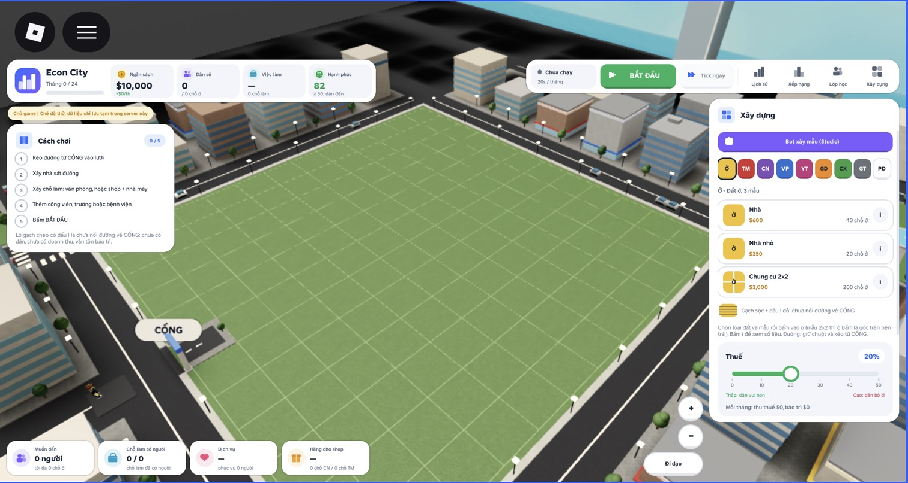
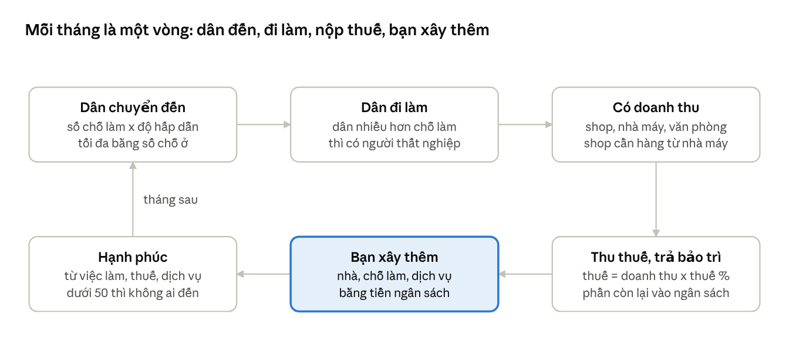
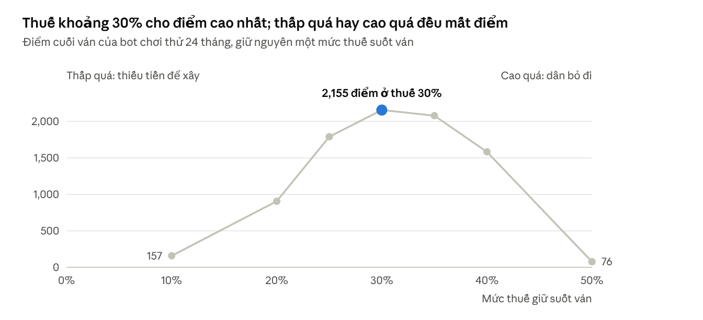

# Hướng dẫn chơi Econ City

## Econ City là gì

Bạn làm thị trưởng một thành phố trong 24 tháng. Việc của bạn là quy hoạch đất, xây công trình và đặt thuế sao cho dân
có việc làm, sống vui và thành phố không hết tiền.

- Khu đất của bạn là một lưới 12 x 12 ô, có sẵn một lối vào gọi là **CỔNG**.
- Bạn bắt đầu với **$10,000** và thuế **20%**.
- Mỗi tháng trôi qua trong 20 giây, nên một ván dài khoảng 8 phút. Bạn có thể tạm dừng bất cứ lúc nào.
- Hết 24 tháng là **hoàn thành nhiệm kỳ**. Nếu ngân sách âm quá **$5,000** thì thành phố **phá sản** và ván kết thúc sớm.

Điểm cuối ván tính theo số người dân vừa có việc làm vừa hạnh phúc, cộng thêm tiền còn trong ngân sách. Chỉ xây thật
nhiều nhà thì không được điểm cao.

## Màn hình chính

Mọi thứ bạn cần theo dõi nằm ở bốn góc màn hình, thành phố ở giữa.



*Màn hình lúc bắt đầu ván mới. Ảnh chụp khi chạy thử trong Roblox Studio, nên có thêm nút "Bot xây mẫu", "Tick ngay" và
dòng chữ vàng mà khi chơi thật bạn sẽ không thấy.*

| Vị trí | Thành phần | Dùng để |
| --- | --- | --- |
| Trên trái | Thẻ thành phố | Xem tháng hiện tại (ví dụ Tháng 7 / 24) và bốn chỉ số: Ngân sách, Dân số, Việc làm, Hạnh phúc |
| Trên trái, bên dưới | Thẻ Cách chơi và cảnh báo | Làm theo 5 bước đầu tiên; đọc cảnh báo khi thành phố gặp vấn đề |
| Trên phải | Nút chính | BẮT ĐẦU, TẠM DỪNG, CHẠY TIẾP; hết ván thì thành VÁN MỚI |
| Trên phải | Lịch sử, Xếp hạng, Lớp học, Xây dựng | Mở biểu đồ các tháng, bảng điểm, vào lớp của giáo viên, ẩn/hiện bảng Xây dựng |
| Bên phải | Bảng Xây dựng | Chọn loại đất và mẫu công trình, bấm **i** để xem số liệu, kéo thanh Thuế |
| Dưới trái | Dải thống kê | Muốn đến, Chỗ làm có người, Dịch vụ, Hàng cho shop |
| Dưới phải | Nút + và −, nút Đi dạo | Phóng to, thu nhỏ; đi bộ trong thành phố bằng WASD hoặc cần điều khiển |

Khi đi dạo bạn vẫn xây được: chọn mẫu rồi bấm vào ô. Trên điện thoại, vuốt là xoay camera, chạm nhẹ mới là xây.

## 5 bước đầu tiên

Ván mới luôn bắt đầu ở trạng thái tạm dừng, nên bạn cứ xây xong rồi mới bấm BẮT ĐẦU. Thẻ Cách chơi sẽ đánh dấu từng
bước khi bạn làm xong.

1. **Kéo đường từ CỔNG vào lưới.** Chọn ô **GT** (Giao thông), giữ chuột ở ô CỔNG rồi kéo vào trong. Mỗi ô đường giá
   $50, mỗi lần kéo tối đa 24 ô.
2. **Xây nhà sát đường.** Chọn **Ở** (Đất ở), chọn mẫu **Nhà** rồi bấm vào một ô trống cạnh đường.
3. **Xây chỗ làm.** Văn phòng chạy một mình được. Shop thì phải có nhà máy đi kèm để có hàng bán.
4. **Thêm công viên, trường hoặc bệnh viện** để dân vui.
5. **Bấm BẮT ĐẦU.** Thời gian bắt đầu chạy và dân dần chuyển đến.

Mọi công trình phải nằm cạnh một ô đường nối liền về CỔNG thì mới hoạt động. Công trình chưa nối đường hiện gạch sọc và
dấu **!** đỏ, không có dân, không có doanh thu nhưng vẫn tốn tiền bảo trì.

**Gợi ý xây đầu ván** (vừa đủ $10,000):

| Xây | Số lượng | Giá | Được gì |
| --- | --- | --- | --- |
| Đường | khoảng 5 ô | $250 | Nối mọi thứ về CỔNG |
| Nhà | 2 | $1,200 | 80 chỗ ở |
| Văn phòng | 1 | $3,000 | 20 chỗ làm |
| Shop | 1 | $1,600 | 20 chỗ làm |
| Nhà máy | 1 | $1,200 | 30 chỗ làm, đủ hàng cho shop |
| Công viên | 1 | $1,800 | Phục vụ 100 dân |
| **Tổng** | | **$9,050** | Còn lại $950 |

Với cách xây này, sau vài tháng thành phố có khoảng 80 dân và bắt đầu có lãi. Sau đó bạn dùng tiền lãi để mở rộng dần.

## Các loại công trình

Có 8 loại đất, mỗi loại một màu và một mã trên bảng Xây dựng. Nhà cho chỗ ở, shop/nhà máy/văn phòng cho việc làm và
doanh thu, y tế/giáo dục/cây xanh làm dân vui.

| Loại đất | Mẫu | Kích thước | Giá xây | Bảo trì/tháng | Cho thành phố |
| --- | --- | --- | --- | --- | --- |
| Ở - Đất ở | Nhà | 1 ô | $600 | $10 | 40 chỗ ở |
| Ở - Đất ở | Nhà nhỏ | 1 ô | $350 | $6 | 20 chỗ ở |
| Ở - Đất ở | Chung cư | 2x2 | $3,000 | $60 | 200 chỗ ở |
| TM - Thương mại | Shop | 1 ô | $1,600 | $60 | 20 chỗ làm, $105/người, cần hàng |
| TM - Thương mại | Quán cà phê | 1 ô | $900 | $35 | 10 chỗ làm, $100/người, cần hàng |
| TM - Thương mại | Siêu thị | 2x2 | $7,000 | $260 | 90 chỗ làm, $110/người, cần hàng |
| CN - Công nghiệp | Nhà máy | 1 ô | $1,200 | $80 | 30 chỗ làm, $55/người |
| CN - Công nghiệp | Xưởng nhỏ | 1 ô | $700 | $45 | 15 chỗ làm, $55/người |
| CN - Công nghiệp | Nhà máy lớn | 2x2 | $5,000 | $320 | 130 chỗ làm, $58/người |
| VP - Văn phòng | Văn phòng | 1 ô | $3,000 | $100 | 20 chỗ làm, $160/người |
| VP - Văn phòng | Văn phòng nhỏ | 1 ô | $1,500 | $55 | 10 chỗ làm, $155/người |
| VP - Văn phòng | Tháp văn phòng | 2x2 | $14,000 | $420 | 90 chỗ làm, $170/người |
| YT - Y tế | Bệnh viện | 1 ô | $2,400 | $120 | 10 điểm dịch vụ, 20 chỗ làm |
| YT - Y tế | Trạm y tế | 1 ô | $1,200 | $60 | 5 điểm dịch vụ, 8 chỗ làm |
| GD - Giáo dục | Trường học | 1 ô | $2,000 | $100 | 10 điểm dịch vụ, 20 chỗ làm |
| GD - Giáo dục | Trường lớn | 2x2 | $7,000 | $350 | 40 điểm dịch vụ, 80 chỗ làm |
| CX - Cây xanh | Công viên | 1 ô | $1,800 | $100 | 5 điểm dịch vụ |
| CX - Cây xanh | Công viên lớn | 2x2 | $6,000 | $360 | 22 điểm dịch vụ |
| GT - Giao thông | Đường | 1 ô | $50 | $0 | Nối công trình về CỔNG |

"$105/người" là doanh thu mỗi người làm tạo ra trong một tháng. Thành phố thu thuế trên khoản doanh thu này. Mỗi điểm
dịch vụ đủ phục vụ 20 dân.

- **Shop** bán được nhiều nhưng cần hàng. Mỗi người làm ở nhà máy làm ra hàng cho một người bán ở shop.
- **Nhà máy** rẻ, nhiều chỗ làm nhưng doanh thu mỗi người thấp.
- **Văn phòng** đắt nhưng doanh thu mỗi người cao nhất, không phụ thuộc ai. Rất có lợi khi lưới gần đầy.
- **Bệnh viện, trường học** vừa làm dân vui vừa tạo việc làm. **Công viên** không cần người làm.
- **Mẫu nhỏ** rẻ, hợp lúc ít tiền. **Mẫu 2x2** đắt, lãi mỗi ô cao hơn, hợp giữa và cuối ván khi đã dư tiền và lưới bắt
  đầu chật.
- Mẫu 2x2 đặt bằng ô góc trên bên trái, cả 4 ô phải trống và nằm trọn trong lưới.
- **Phá dỡ** được hoàn lại 50% giá xây. Dùng công cụ **PD**, hoặc bấm vào công trình rồi bấm nút Phá dỡ hai lần. Phá
  đường có thể làm công trình khác mất nối.

Bấm nút **i** cạnh mỗi mẫu để xem đủ số liệu trước khi xây.

## Mỗi tháng diễn ra gì

Dân chỉ chuyển đến khi có việc làm và thành phố đủ vui. Mỗi tháng game tính theo thứ tự sau:

1. **Dân đến hoặc đi.** Số dân muốn đến bằng số chỗ làm nhân với độ hấp dẫn, nhưng không vượt quá số chỗ ở. Mỗi tháng
   dân số đi được nửa quãng tới con số đó.
2. **Dân đi làm.** Dân nhiều hơn chỗ làm thì có người thất nghiệp. Chỉ số Việc làm là phần trăm dân có việc.
3. **Doanh nghiệp có doanh thu.** Shop chỉ bán được phần có hàng từ nhà máy.
4. **Thành phố thu thuế và trả bảo trì.** Tiền thuế = doanh thu x thuế suất. Bảo trì tính cho mọi công trình, kể cả
   công trình chưa nối đường.
5. **Tính hạnh phúc** từ việc làm, thuế và dịch vụ. Con số này quyết định dân đến hay đi ở tháng sau.



Bạn đứng ở ô "Bạn xây thêm": mỗi lần xây hay đổi thuế đều quay vòng lại, ảnh hưởng tới số dân tháng sau.

**Độ hấp dẫn** phụ thuộc hạnh phúc của tháng trước:

| Hạnh phúc tháng trước | Số dân muốn đến |
| --- | --- |
| Dưới 50 | Không ai đến |
| Từ 50 đến 75 | Tăng dần theo hạnh phúc |
| Từ 75 trở lên | Tối đa, bằng 1,2 lần số chỗ làm |

Thành phố rất vui sẽ có người đến nhiều hơn số chỗ làm. Khi đó có người thất nghiệp và hạnh phúc giảm xuống, nên thành
phố tự cân bằng.

**Hạnh phúc** (từ 0 đến 100) được tính như sau:

```
H = 0.35E + 0.45(100 - 2T) + 0.20S
```

- E là phần trăm dân có việc làm.
- T là thuế suất (%). Thuế càng cao, hạnh phúc càng thấp.
- S là phần trăm dân được phục vụ dịch vụ. Mỗi điểm dịch vụ phục vụ 20 dân.

Ví dụ: thành phố có 400 dân, 1 bệnh viện và 1 công viên. Hai công trình đó cho 15 điểm, phục vụ 300 người, nên S = 75.
Với E = 100 và thuế 20%, hạnh phúc là 35 + 27 + 15 = 77.

## Thuế

Thuế khoảng 30% thường cho kết quả tốt nhất. Thuế thấp quá thì thiếu tiền để xây. Thuế cao quá thì dân bỏ đi và tiền
thuế thu về lại ít hơn.

- Kéo thanh **Thuế** ở cuối bảng Xây dựng, từ 0% đến 50%. Đổi lúc nào cũng được, có tác dụng từ tháng sau.
- Dòng "Mỗi tháng: thu thuế ..., bảo trì ..." dưới thanh thuế cho biết thành phố đang lãi hay lỗ.

Bảng dưới cho thấy thuế làm hạnh phúc và số dân muốn đến thay đổi ra sao. Ví dụ này giả sử ai cũng có việc (E = 100) và
dịch vụ phục vụ 75% dân (S = 75).

| Thuế | Hạnh phúc | Dân muốn đến, so với số chỗ làm |
| --- | --- | --- |
| 20% | 77 | 120% |
| 30% | 68 | 86% |
| 40% | 59 | 43% |
| 50% | 50 | 0%, không ai đến |

Tăng thuế từ 30% lên 40% thì mỗi người nộp nhiều hơn. Nhưng số người muốn đến giảm còn một nửa, nên tổng tiền thuế lại
giảm. Trong kinh tế học, hiện tượng này gọi là **đường cong Laffer**.



*Điểm của bot chơi thử theo luật của game, chiến thuật cân bằng, 7 mức thuế.*

Bạn có thể tự kiểm tra: chơi hai ván với hai mức thuế khác nhau, rồi so biểu đồ trong Lịch sử.

## Kết thúc ván và điểm số

Ván kết thúc khi hết 24 tháng ("Hoàn thành nhiệm kỳ!") hoặc khi ngân sách âm quá $5,000 ("Thành phố phá sản"). Ngân
sách được phép âm một chút, nhưng lúc âm thì bạn không xây được gì.

**Điểm** được tính như sau, làm tròn và không nhỏ hơn 0:

```
Điểm = số dân có việc x hạnh phúc / 100 + ngân sách / 100
```

Ví dụ: cuối ván có 70 người có việc, hạnh phúc 78, ngân sách $24,876. Điểm = 70 x 78 / 100 + 24,876 / 100 = 54,6 +
248,76, làm tròn là 303.

Dân thất nghiệp không được tính điểm. Vì vậy xây thật nhiều nhà mà không có chỗ làm thì không giúp ích.

- **Màn kết thúc** hiện điểm, kỷ lục và các chỉ số cuối ván. Bạn chọn CHƠI VÁN MỚI, Xem lịch sử hoặc Ngắm thành phố.
  Bằng hoặc vượt điểm cao nhất cũ sẽ hiện "Kỷ lục mới!".
- **Lịch sử** vẽ biểu đồ từng tháng cho ngân sách, doanh thu của doanh nghiệp, hạnh phúc, tỉ lệ việc làm và dân số. Xem
  nó để biết tháng nào thành phố đi xuống và vì sao.
- **Xếp hạng** có hai tab: Toàn cầu và Lớp của tôi. Mỗi người giữ điểm cao nhất của mình, bảng cập nhật sau mỗi 2 lượt.

## Chơi theo lớp học

Giáo viên sẽ đưa cho bạn một mã mời gồm 6 ký tự. Vào lớp bằng mã đó để giáo viên theo dõi được thành phố của bạn.

1. Bấm **Lớp học** ở góc trên bên phải.
2. Ở mục **Tham gia lớp**, nhập mã mời (ví dụ QZ7K2M) rồi bấm **Tham gia**.
3. Lớp hiện trong mục **Lớp của tôi**, kèm tên giáo viên.
4. Nếu giáo viên mở phòng học riêng, bấm **Vào phòng học** để chơi cùng cả lớp.

Sau khi vào lớp, tab Lớp của tôi trong Xếp hạng sẽ so điểm của bạn với các bạn cùng lớp. Muốn rời lớp thì bấm
**Rời lớp**.

Giáo viên có thể gán **sự kiện** cho cả lớp. Khi có sự kiện, màn hình hiện tên sự kiện và số tháng còn lại.

| Sự kiện | Ảnh hưởng | Kéo dài |
| --- | --- | --- |
| Suy thoái kinh tế | Doanh thu chỉ còn 70% | 4 tháng |
| Đứt gãy chuỗi cung ứng | Nhà máy chỉ làm ra một nửa hàng | 4 tháng |
| Đại dịch | Mỗi tháng 2% dân bỏ đi, hạnh phúc giảm 10 | 6 tháng |
| Bão giá vật liệu | Giá xây tăng 50%, bảo trì tăng 30% | 5 tháng |

Giáo viên còn có thể tự tạo kịch bản khác với mức ảnh hưởng riêng.

## Mẹo chơi và lỗi thường gặp

Khi thành phố gặp vấn đề, game hiện cảnh báo ở góc trên bên trái. Cảnh báo không làm bạn thua ngay, nhưng nên xử lý
sớm.

| Cảnh báo | Nên làm gì |
| --- | --- |
| Ngân sách âm: đang lỗ, chưa xây được gì | Tăng thuế một chút, hoặc phá công trình chưa dùng tới (được hoàn 50%) |
| Hạnh phúc dưới 50: không ai muốn chuyển đến | Giảm thuế, thêm công viên, trường hoặc bệnh viện |
| Việc làm dưới 80%: thiếu chỗ làm | Xây thêm văn phòng, shop hoặc nhà máy, tạm ngừng xây nhà |
| Shop thiếu hàng: cần thêm nhà máy | Xây thêm nhà máy hoặc xưởng nhỏ |

Nếu bấm xây mà không được, đọc thông báo đỏ hiện ra:

| Thông báo | Lý do |
| --- | --- |
| Không đủ tiền: cần ... | Ngân sách ít hơn giá xây. Chờ thêm vài tháng hoặc chọn mẫu nhỏ |
| Ô này đã có công trình | Chọn ô trống khác, hoặc phá công trình cũ trước |
| Chung cư cần 2x2 ô trống | Mẫu 2x2 cần đủ 4 ô trống, tính từ ô góc trên bên trái |
| ... tràn ra ngoài lưới | Mẫu 2x2 đặt quá sát mép phải hoặc mép dưới |
| Đoạn đường đi qua ô đã có công trình | Đường kéo cắt ngang một công trình, nên cả đoạn không được xây |
| Mỗi lần kéo tối đa 24 ô | Chia đoạn đường dài thành nhiều lần kéo |

**Mẹo:**

- Xây chỗ làm trước rồi mới xây thêm nhà. Dân đến vì có việc, không phải vì có nhà.
- Giữ số chỗ làm ở nhà máy ít nhất bằng số chỗ làm ở shop. Mục "Hàng cho shop" ở dải thống kê nên ở 100%.
- Cứ 100 dân cần 5 điểm dịch vụ. Một công viên đủ cho 100 dân, một bệnh viện hoặc trường học đủ cho 200 dân.
- Bấm TẠM DỪNG khi cần suy nghĩ. Lúc tạm dừng bạn vẫn xây được.
- Để dành mẫu 2x2 cho giữa và cuối ván. Mua sớm dễ hết tiền xây chỗ làm.
- Chỉ xây shop mà không xây nhà máy sẽ phá sản, vì shop không có hàng để bán.

## Câu hỏi sau khi chơi

Sau mỗi ván, hãy mở Lịch sử và trả lời các câu hỏi dưới đây. Đây là những bài học kinh tế mà game muốn bạn tự rút ra.

1. Vì sao xây thêm nhà mà dân số không tăng? Thứ gì mới thật sự kéo dân đến?
2. Khi bạn tăng thuế, tiền thuế mỗi tháng thay đổi thế nào trong 2-3 tháng sau đó? Có lúc nào tăng thuế mà thu về ít
   hơn không?
3. Bệnh viện, trường học và công viên không tạo doanh thu. Vậy vì sao thành phố vẫn nên xây chúng?
4. Vì sao shop cần nhà máy? Ngoài đời, hàng hóa trong cửa hàng đến từ đâu?
5. Khi gặp một sự kiện như suy thoái hay đại dịch, chỉ số nào thay đổi trước? Bạn đã làm gì để thành phố vượt qua?
6. Văn phòng đắt gần gấp đôi shop. Khi nào xây văn phòng có lợi hơn?
7. Nếu được chơi lại, bạn sẽ đổi điều gì đầu tiên, và vì sao?
